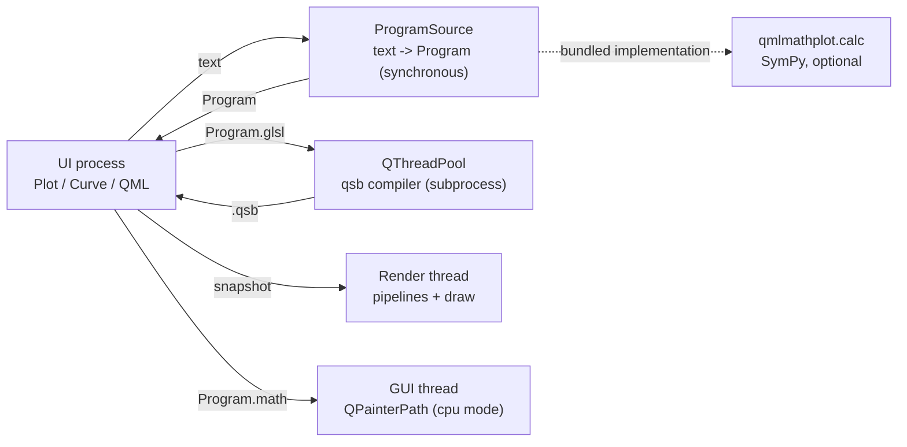

# Architecture

This page describes the 0.7 layout. The original design rationale (the camera model, the
Matplotlib vocabulary decisions) is in [api-design.md](api-design.md); this page is the map
of the code as it is today.

## The one rule

**The core consumes `Program`s; it never parses text, never imports SymPy, and owns no
process.**

`Program` (`qmlmathplot/protocol.py`) is a frozen dataclass and the only contract between
the model and an expression source:

| field | meaning |
|---|---|
| `text` | canonical input text (what the user typed) |
| `kind` | `"intervals"`, `"adaptive"`, `"implicit"` or `"data"` |
| `args` | `("x",)` for a function, `("x", "y")` for a level set |
| `glsl` | stage → source: `{"compute": …}` or `{"fragment": …}` |
| `math` | a complete Python function definition (`math` module) |
| `numpy` | a complete Python function definition (`numpy` module) |
| `error` | a parse/analysis error; empty when the program is drawable |

Everything is plain data: it can cross a process boundary as JSON (or pickle), and it can be
stored or compared.

## Data flow



1. A host creates a `Plot` and passes a `ProgramSource` (`Plot(program_source=…)`).
2. Assigning text (`add_curve`, `Curve.expression`) calls the source **synchronously** and
   receives a `Program`. `curve.program` is available as soon as the call returns.
3. If the program has GLSL, its shaders are compiled by `qsb` on a thread pool
   (`Curve._apply_program`). This includes the **first** bake; the UI thread never runs
   `qsb`. The curve is absent from the render snapshot until its shaders exist (or keeps its
   previous shaders when the new bake is still running).
4. A stale bake (a newer expression was assigned meanwhile) is discarded by the curve's
   generation counter; a failed bake keeps the previous shaders and sets `curve.error`.
5. The renderer receives a snapshot of baked URLs and draws. In CPU mode the same snapshot
   is replaced by QPainter items driven by `Program.math`.

`ProgramSource` is a protocol, not a base class:

```python
class ProgramSource(Protocol):
    def program(self, text: str, *, implicit: bool | None = None) -> Program: ...
```

The bundled implementation is `qmlmathplot.calc.SymPyProgramSource` (the `[calc]` extra).
There is **no default source**: a `Plot()` without one raises
`ProgramSourceMissingError` when text is added, while `add_program()` and `add_points()`
work without any source.

## Threads and processes

| thread/process | does | must not do |
|---|---|---|
| GUI thread | owns the model; calls the synchronous source; updates QML | run `qsb`, block on a bake |
| `QThreadPool` | `qsb` (one job per program) | touch the model |
| render thread | creates QRhi pipelines from baked `.qsb`, draws | parse, compile shaders, call the source |
| calculator process (optional, host-owned) | SymPy / any expression compiler | touch Qt objects |
| CPU paint (GUI thread) | `curveplotter` + `QPainterPath` in cpu mode | block the event loop for long sampling |

The library does not start or manage a calculator process. `examples/process_calculator.py`
shows a host doing it: the worker returns a `Program`, the UI calls `Plot.add_program`.

## Renderers

| `Program.kind` | GPU mode | CPU mode |
|---|---|---|
| `intervals` | compute shader: one sequential invocation walks the screen columns and runs the GeoGebra interval-path state machine (`calc/ggb_compute.py` + `shaders/interval_path.comp`) | `curveplotter` samples `Program.math` into a `QPainterPath` |
| `implicit` | fragment shader: per-pixel signed distance, domain/pole guards and a marching cell (`shaders/implicit.frag`) | **not supported**: the view shows “implicit curves need the GPU renderer” |
| `adaptive` | `curveplotter` builds a world-space path on the CPU, `stroke_vertices` turns it into screen quads, the shared `path.vert/path.frag` pipeline strokes them | same path drawn by QPainter |
| `data` | point polyline, stroked by the shared path pipeline | not drawn yet (see [Rendering modes](rendering.md)) |

Both the compute output and the CPU-generated path use the same stroke pipeline (vertex
layout, line width, join discs, MSAA), so the stroke is identical even though the geometry
producer differs.

## Module map

```
qmlmathplot/
  protocol.py        Program, ProgramSource, framing (no Qt, no SymPy)
  program.py         compile a Program source into a callable (explicit empty builtins)
  plot.py            Plot: camera, curves, annotations, guides, styling, export
  camera.py          Camera: centre, zoom, aspect, derived ranges, ticks, input
  curve.py           Curve / CurveListModel: expression -> Program -> baked shaders
  view.py            QML type registration and component path
  rhi.py             CurveRhiItem: one QQuickRhiItem, one pipeline per program
  curveplotter.py    GeoGebra CurvePlotter port for adaptive 1-D paths
  pathcurve.py       CPU fallback: QPainterPath from Program.math
  export.py          offscreen Qt image export (lazy QtWidgets)
  mpl.py             optional matplotlib hand-off (samples Program.numpy, no SymPy)
  widget.py          MathPlotWidget (QQuickWidget bridge)
  app.py             command-line window
  qml/               PlotView, PlotCurves, CpuCurves, PlotFurniture, PlotInput, ...
  shaders/           GLSL sources + common @INCLUDE blocks
  qsb.py, shaderbuild.py   shader baking and template assembly
  calc/              the calculator package: the only SymPy importer
    build.py         text -> Program
    model.py         expression -> GLSL and Python sources
    interval.py      the interval GLSL emitter
    ggb_compute.py   the interval compute shader generator
    ggb_eligibility.py  GeoGebra's interval eligibility gate
    ggb_reference.py, interval_reference.py   test oracles (mpmath / Python intervals)
  ggb_path.py        pure-Python interval-path state machine (shared spec)
```

`ggb_path.py` stays in the core because it is pure Python and is the specification mirrored
by the compute shader; it is not imported by the renderer.

## Invariants worth preserving

- `import qmlmathplot`, `from qmlmathplot import Plot` and `qmlmathplot.view` do not load
  SymPy. `qmlmathplot.calc` is the only runtime importer.
- `Program` is the only cross-layer data; no `sympy.Expr` or callable crosses it.
- `Program.compile` runs with an explicit `__builtins__ = {}`; treat the calculator as the
  trust boundary.
- The GUI thread never runs `qsb`; `Curve.program` is synchronous, the shaders are not.
- A failed parse or bake never raises into QML: it lands in `curve.error` and
  `plot.plotError`, and the previous drawing stays.
- A window that has no RHI backend uses `QT_QUICK_BACKEND=software` + `renderMode="cpu"`;
  the RHI item is not instantiated in that mode.
