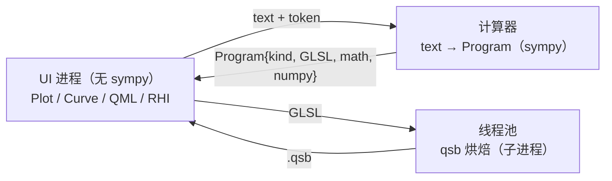

# QMLMathPlot 0.6 简略说明（中文）

本文是 0.6 的速览：架构、API、进程隔离、数据点，以及 `examples/explorer_qtquick.py` 的设计。

## 1. 架构：模型不解析表达式



- **`Program`**（`qmlmathplot.protocol`）是唯一跨层契约，纯 JSON：`kind`（`intervals` / `adaptive` /
  `implicit` / `data`）、`glsl`、`math` 源码、`numpy` 源码、`error`。
- **计算器** 负责解析与源码生成：`InlineCalculator`（默认，同进程，首次请求才 import sympy）或
  `ProcessCalculator`（`python -m qmlmathplot.calc`）。库**不**管理进程生命周期。
- **模型** 只消费 `Program`：`Curve` 请求程序 → 收到后在线程池烘焙 shader；失败保留上一次绘制。
- **渲染路由**：`intervals` → compute shader；`implicit` → fragment shader；`adaptive` → CPU
  `CurvePlotter`（几何 CPU，笔画走同一条 GLSL 管线）；`data` → 点集折线（同一笔画管线）。
- 包导入是惰性的：`import qmlmathplot` 不加载 Qt 也不加载 sympy。

## 2. 快速开始

```python
from PySide6.QtGui import QGuiApplication
from PySide6.QtQuick import QQuickView
from PySide6.QtCore import QUrl
from qmlmathplot import Plot, qml_component_path, register_qml_types

app = QGuiApplication([])
register_qml_types()
plot = Plot()
plot.add_curve("sin(1/x)")
plot.add_points([0, 1, 2, 3], [0, 1, 4, 9])      # 数据点，NaN/inf 断开
view = QQuickView()
view.setSource(QUrl.fromLocalFile(qml_component_path()))
view.rootObject().setProperty("plot", plot)
view.show()
app.exec()
```

QML 侧：`import QmlMathPlot 2.0`，`PlotView { plot: backendPlot }`。
QtWidgets 宿主仍可用 `MathPlotWidget("sin(x)")`。

`Curve` 是异步的：赋值 `expression` 后，着色器随 `Program` 到达（`shadersChanged`）；
`curve.error` 非空表示该次编辑失败，画面保留上一次成功的表达式。

## 3. 进程隔离（推荐给 App）

```python
from qmlmathplot import Plot
from qmlmathplot.client import ProcessCalculator

plot = Plot()
plot.calculator = ProcessCalculator(parent=plot)   # 子进程：python -m qmlmathplot.calc
plot.add_curve("sin(1/x)")
```

- UI 进程因此不再 import sympy；`examples/process_calculator.py --check-isolation`
  启动后会断言这一点（测试 `tests/test_no_sympy_ui.py` 也钉住）。
- 通信是 4 字节长度前缀 + UTF-8 JSON；工作进程崩溃/超时通过 `failed` 报告，旧画面保留。
- 宿主也可以自己实现计算器：只要产出 `Program` 即可（任意语言/传输）；库只提供协议与
  `ProcessCalculator` 便捷实现。

## 4. 渲染模式

QML `PlotView` 的 `renderMode`：

| 值 | 行为 |
|---|---|
| `"auto"`（默认）/ `"gpu"` | 走 RHI：compute / fragment / CPU 路径顶点 + 共享笔画管线 |
| `"cpu"` | 每条曲线一个 `QPainterPath`（`CurvePlotter` 几何）；隐函数暂不支持 |

## 5. `examples/explorer_qtquick.py` 设计说明

它是一个**纯 Qt Quick 的“共存”探针**，用来看绘图组件是否与常见邻居争夺事件/焦点，而不只是一个
“能画出 sin(x)”的 demo。启动器只做三件事：注册 QML 类型、加载 `explorer_qtquick.qml`、
进入事件循环；模型与交互都在 QML 里。

窗口结构（`ApplicationWindow`）：

- **header / ToolBar**：表达式输入框（回车或 Draw 重画）、示例下拉、纵横比下拉、主题选择、
  Reset view。表达式写进 `view.plot.curves.at(0)`，错误文本用命令式赋值刷新。
- **SplitView**：左侧 `PlotView`（`objectName: "plot"`），右侧日志面板；拖动分隔条会改变绘图区
  尺寸，用来验证相机在可变尺寸下不扭曲。
- **Overlay**：绘图区左上角一个半透明 `Item`。它没有指针处理器，所以鼠标事件直接穿透——
  这也是 Qt Quick 相比 QtWidgets 不需要 `WA_TransparentForMouseEvents` 的原因。
- **日志**：`logLine()` 追加“draw / aspect / theme”等事件，便于肉眼确认谁收到了输入。

三个有意的设计点（来自踩过的坑）：

1. **模型归 App 所有**：`Component.onCompleted` 里由外部 `add_curve` 加入曲线，组件自身的默认
   曲线只在模型为空时添加；因此“谁先创建”不会产生两条曲线。
2. **不使用 `curves.at(0).error` 绑定**：父组件的 `Component.onCompleted` 早于子组件，绑定在
   曲线存在前求值会得到空值且不会重算；所以 `draw()` 里命令式地写 `errorLabel.text`。
3. **绘图区不加入 Tab 焦点链**（`PlotInput.qml` 的实现），输入框获得焦点时不会被打断；拖拽/
   滚轮由 QML 侧 `accepted`，不会泄漏给父级。

`tests/test_qtquick_coexistence.py` 覆盖同一组冲突（Flickable 抢拖拽、Tab 进出），
示例本身则用于人眼检查与手测；分进程用法见 `examples/process_calculator.py`。

## 6. 与 0.5 的差异（迁移速查）

| 0.5 | 0.6 |
|---|---|
| `sympy` 是核心依赖 | `sympy` 只在 `[calc]` extra 中 |
| `Curve` 同步解析并烘焙 | 异步：`Program` 到达后才有 shader |
| `Curve.expr` 是内部表示 | 已弃用；内部用 `Program`，`expr` 为懒加载 sympy 视图 |
| `Figure` / `Axes` / `pyplot` | 已删除（`Plot` / `Camera` / `Curve`） |
| `cpuRenderer: true` | `renderMode: "cpu"` |
| QML `QmlMathPlot 1.0` | `QmlMathPlot 2.0` |
| `add_curve("a*x")` 抛异常 | 曲线带 `error`，由 UI 展示 |
| 无数据点 | `Plot.add_points(x, y)`（numpy 数组可用） |
