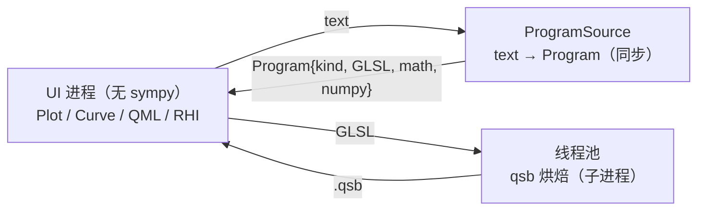

# QMLMathPlot 0.7 简略说明（中文）

本文是 0.7 的速览：架构、API、进程隔离、渲染模式、数据点，以及
`examples/explorer_qtquick.py` 的设计。

## 1. 架构：核心只认 `Program`



- **`Program`**（`qmlmathplot.protocol`）是唯一跨层契约，纯 JSON：`kind`
  （`intervals` / `adaptive` / `implicit` / `data`）、`glsl`、`math` 源码、`numpy` 源码、
  `error`。
- 核心（`Plot`/`Curve`/`PlotView`/RHI）**不解析文本、不 import sympy、不包含 subprocess**。
- 文本由显式注入的 **`ProgramSource`** 同步解析：`SymPyProgramSource`（`[calc]` extra）或宿主
  自己的实现。没注入时，`add_curve("...")` 抛 `ProgramSourceMissingError`；`add_program()` 与
  `add_points()` 不需要 source。
- `qmlmathplot.calc` 是 SymPy 前端（`[calc]`）与 worker 入口；
  `examples/process_calculator.py` 展示进程往返，进程生命周期由宿主管理。
- 首次与后续 qsb 烘焙都在线程池（没有事件循环的脚本除外），结果用 generation 丢弃过期值；
  失败写入 `curve.error` / `plot.plotError`，保留上一张图。
- `import qmlmathplot` 不加载 Qt 也不加载 sympy。

## 2. 快速开始

```python
from PySide6.QtGui import QGuiApplication
from PySide6.QtQuick import QQuickView
from PySide6.QtCore import QUrl
from qmlmathplot import Plot, qml_component_path, register_qml_types
from qmlmathplot.calc import SymPyProgramSource

app = QGuiApplication([])
register_qml_types()
plot = Plot(program_source=SymPyProgramSource())
plot.add_curve("sin(1/x)")                 # 同步得到 Program，随后异步烘焙 shader
plot.add_points([0, 1, 2, 3], [0, 1, 4, 9])  # 纯数据，NaN/inf 断开
view = QQuickView()
view.setSource(QUrl.fromLocalFile(qml_component_path()))
view.rootObject().setProperty("plot", plot)
view.show()
app.exec()
```

QML 侧：`import QmlMathPlot 2.0`，`PlotView { plot: backendPlot }`。
QtWidgets 宿主：`MathPlotWidget("sin(x)", program_source=SymPyProgramSource())`。

`Curve` 的 `expression` 是文本；`curve.program` 是正在绘制的程序；`shadersChanged` 表示
着色器就绪；出错时 `curve.error` 非空、画面保持上一次成功的表达式。

## 3. 进程 / 计算器在外部

核心不创建进程。宿主有两种模式：

1. **同步 source**：`SymPyProgramSource`（`[calc]`），或宿主自己实现 `program(text, implicit=None)`
   → `Program`。
2. **外部 worker**：worker 返回 `Program`，UI 调 `plot.add_program(program)`（或
   `curve.set_program`）。UI 进程因此完全不需要 sympy。

`examples/process_calculator.py` 是最小示例：

```
python examples/process_calculator.py --check-isolation
# program: intervals; error: ''; sympy in UI process: False
```

它只做一次同步的“请求 → 读取帧 → 反序列化 `Program`”，然后 `add_program`；worker 是
`python -m qmlmathplot.calc`。Symplify 的集成方式相同，只是 worker 在它自己的进程里。

## 4. 渲染模式

`PlotView.renderMode`：

| 值 | 行为 |
|---|---|
| `"gpu"`（默认） | RHI：compute / fragment / CPU 路径顶点 + 共享笔画管线 |
| `"cpu"` | 每条 1-D 曲线一个 `QPainterPath`（`CurvePlotter` 几何）；隐函数显示明确提示 “implicit curves need the GPU renderer” |

没有运行时 `"auto"` 探测：是否使用 GPU 由宿主决定。

## 5. `examples/explorer_qtquick.py` 设计说明

它是一个**纯 Qt Quick 的“共存”探针**，用来看绘图组件是否与常见邻居争夺事件/焦点，而不只是
“能画出 sin(x)”的 demo。启动器只做三件事：注册 QML 类型、加载 `explorer_qtquick.qml`、
进入事件循环；模型与交互都在 QML 里。

窗口结构（`ApplicationWindow`）：

- **header / ToolBar**：表达式输入框（回车或 Draw 重画）、示例下拉、纵横比下拉、主题选择、
  Reset view。表达式写进 `view.plot.curves.at(0)`，错误文本用命令式赋值刷新。
- **SplitView**：左侧 `PlotView`（`objectName: "plot"`），右侧日志面板；拖动分隔条会改变绘图区
  尺寸，用来验证相机在可变尺寸下不扭曲。
- **Overlay**：绘图区左上角一个半透明 `Item`。它没有指针处理器，所以鼠标事件直接穿透——
  这也是 Qt Quick 相比 QtWidgets 不需要 `WA_TransparentForMouseEvents` 的原因。
- **日志**：`logLine()` 追加 “draw / aspect / theme” 等事件，便于肉眼确认谁收到了输入。

三个有意的设计点（来自踩过的坑）：

1. **模型归 App 所有**：`Component.onCompleted` 里由外部 `add_curve` 加入曲线，组件自身的默认
   曲线只在模型为空时添加；因此“谁先创建”不会产生两条曲线。
2. **不使用 `curves.at(0).error` 绑定**：父组件的 `Component.onCompleted` 早于子组件，绑定在
   曲线存在前求值会得到空值且不会重算；所以 `draw()` 里命令式地写 `errorLabel.text`。
3. **绘图区不加入 Tab 焦点链**（`PlotInput.qml` 的实现），输入框获得焦点时不会被打断；拖拽/
   滚轮由 QML 侧 `accepted`，不会泄漏给父级。

`tests/test_qtquick_coexistence.py` 覆盖同一组冲突（Flickable 抢拖拽、Tab 进出），
示例本身用于人眼检查与手测；分进程用法见 `examples/process_calculator.py`。

## 6. 0.6 → 0.7 迁移速查

| 0.6 | 0.7 |
|---|---|
| `Plot()` 自带 `InlineCalculator` | `Plot(program_source=SymPyProgramSource())`（显式） |
| 没有 source 时 `add_curve` 静默失败/隐式导入 | `ProgramSourceMissingError`，明确提示 |
| `Plot.calculator` / `qmlmathplot.client` | 删除；进程客户端见 `examples/process_calculator.py` |
| `Curve` 构造即同步烘焙 | 构造时同步得到 `Program`，**qsb 异步** |
| `Curve.expr` / `Plot.to_sympy` | 删除；用 `curve.program`，matplotlib 交接采样 `Program.numpy` |
| `to_matplotlib` 依赖 sympy | 只依赖 matplotlib；隐函数跳过 |
| `renderMode: "auto"` | `"gpu"` / `"cpu"` |
| CPU 模式隐函数静默空白 | 显示明确提示 |
| `Program.compile` 隐式 builtins | 显式 `__builtins__ = {}`（计算器是信任边界） |
