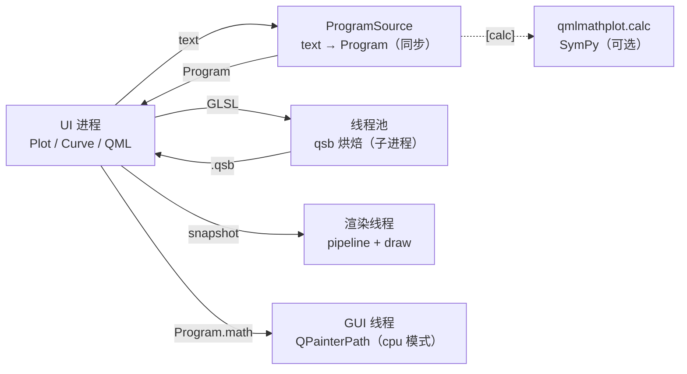

# QMLMathPlot 0.7 中文文档

对应版本 0.7.0。英文详细文档见 [Architecture](architecture.md)、[API](api.md)、
[Programs](programs.md)、[Rendering](rendering.md)、[Migration](migration-0.7.md)。

## 1. 架构：核心只认 `Program`



- **核心不解析文本、不 import SymPy、不包含 subprocess。** 文本由显式注入的同步
  `ProgramSource` 变成 `Program`；核心只消费 `Program`。
- `Program`（`qmlmathplot.protocol`）是唯一跨层契约，纯数据：`text`、`kind`
  （`intervals` / `adaptive` / `implicit` / `data`）、`args`、`glsl`、`math`、`numpy`、
  `error`。可 JSON/pickle，可跨进程。
- `qmlmathplot.calc` 是唯一的 SymPy 运行期导入者，属于 `[calc]` extra。
  `SymPyProgramSource` 是内置的同步实现。
- 没有默认 source：`Plot()` 下 `add_curve("…")` 抛 `ProgramSourceMissingError`；
  `add_program()` / `set_program()` / `add_points()` 不需要 source。
- 文本曲线：`Program` 同步返回，**着色器异步烘焙**（线程池）。bake 失败保留上一张图，
  错误进 `curve.error` / `plot.plotError`，不抛给 QML。
- `import qmlmathplot` / `Plot` / `PlotView` 均不加载 SymPy。

## 2. 安装

```bash
pip install qmlmathplot                 # 核心：PySide6 + numpy
pip install "qmlmathplot[calc]"         # + SymPyProgramSource 与 calc worker
pip install "qmlmathplot[matplotlib]"   # + to_matplotlib / savefig(backend="matplotlib")
```

## 3. 快速开始

```python
from PySide6.QtGui import QGuiApplication
from PySide6.QtQuick import QQuickView
from PySide6.QtCore import QUrl
from qmlmathplot import Plot, qml_component_path, register_qml_types
from qmlmathplot.calc import SymPyProgramSource

app = QGuiApplication([])
register_qml_types()
plot = Plot(program_source=SymPyProgramSource())
plot.add_curve("sin(1/x)")                  # 同步得到 Program，随后异步烘焙 shader
plot.add_points([0, 1, 2, 3], [0, 1, 4, 9]) # 纯数据；NaN/inf 断开
view = QQuickView()
view.setSource(QUrl.fromLocalFile(qml_component_path()))
view.rootObject().setProperty("plot", plot)
view.show()
app.exec()
```

QML：`import QmlMathPlot 2.0`，`PlotView { plot: backendPlot }`。
QtWidgets：`MathPlotWidget("sin(x)", program_source=SymPyProgramSource())`。

`Curve` 的 `expression` 是文本；`curve.program` 是正在绘制的程序；`shadersChanged`
表示着色器就绪；失败时 `curve.error` 非空、画面保持上一次成功的表达式。

## 4. 主要 API

### `Plot`

- 构造：`Plot(parent=None, *, program_source=None)`。
- 属性：`program_source`（Python 属性）、`renderMode`（`"gpu"`/`"cpu"`）、`plotError`、
  `camera`、`curves`、`annotations`、`guides`、`xlim`/`ylim`/`aspect`、`theme`、
  `available_themes`，以及样式属性（`background`、`grid*`、`axis*`、`tick*`、`title*`、
  `legend*`、`line_width`、`color_cycle` 等）。
- 曲线：`add_curve`、`add_program`、`add_points`、`add_implicit`、`remove_curve`。
- 标注/参考线：`annotate`、`add_text`、`add_annotation`、`add_hline`、`add_vline`。
- 刻度：`set_xticks` / `set_yticks`（值+标签）。
- 导出：`to_image(...)`（Qt 光栅，需要 QApplication）、`savefig(path, backend="qt"|"matplotlib")`、
  `to_matplotlib(...)`（采样 `Program.numpy`，不需要 SymPy）。

### `Camera`

`centre`、`zoom`、`aspect`、`scale_x/scale_y`、`xlim/ylim`、`viewport`、`ticks_x/ticks_y`、
`zoomStep`、`panEnabled`、`zoomEnabled`、`animationDuration`、`input`。
方法：`set_view`、`set_viewport`、`zoom_by`、`zoom_at`、`animate_zoom`、`animate_pan`、
`pan_pixels`、`stop_animation`、`reset`。

### `Curve` / `CurveListModel`

`Curve`：`expression`、`program`、`set_program`、`set_program_source`、`implicit`、
`is_data`/`points`、`mathSource`、`color`、`lineWidth`、`visible`、`label`、`error`、
`vertexShader`/`fragmentShader`/`computeShader`。

`CurveListModel` 的 QML role：`curve`、`expression`、`color`、`lineWidth`、`visible`、
`vertexShader`、`fragmentShader`、`label`、`mathSource`、`implicit`。

### `MathPlotWidget`

```python
MathPlotWidget(expression="sin(x)", parent=None, *, plot=None, line_width=None,
               curve_color=None, background_color=None, aspect="auto",
               program_source=None, render_mode="gpu")
```

便利属性/方法：`expression`、`error`、`line_width`、`curve_color`、`background_color`、
`aspect`、`view_bounds()`、`reset_view()`、`zoom()`、`pan_pixels()`。

## 5. ProgramSource 与外部 worker

```python
class ProgramSource(Protocol):
    def program(self, text: str, *, implicit: bool | None = None) -> Program: ...
```

同步契约：`add_curve` 返回时 `curve.program` 已存在；只有 qsb 是异步的。

外部 worker（宿主自己管理进程）：

```python
program = worker.request("sin(1/x)")   # 任意语言/传输，返回 Program
plot = Plot(program_source=None)
plot.add_program(program)
```

`examples/process_calculator.py` 是完整最小示例（4 字节长度 + JSON 帧，
`python -m qmlmathplot.calc`）。worker 只能把帧写到 stdout，诊断写 stderr。

`Program.compile()` 使用显式空 `__builtins__`，程序不可达 `open`/`__import__`；
计算器是信任边界。协议 `schema` 版本不匹配会被拒绝。

## 6. 渲染模式

`Plot.renderMode`（QML 的 `PlotView.renderMode` 跟随）：

| 值 | 行为 |
|---|---|
| `"gpu"`（默认） | RHI：compute（intervals）/ fragment（implicit）/ 共享笔画管线（adaptive、data） |
| `"cpu"` | 每条 1-D 曲线一个 `QPainterPath`；RHI item 不创建；隐函数显示明确提示 |

GPU 受限平台：

```python
import os
os.environ["QT_QUICK_BACKEND"] = "software"   # 必须在 QGuiApplication 之前
plot.renderMode = "cpu"
```

或 `qmlmathplot --software "sin(x)"`（等价于软件场景图 + cpu 模式）。

CPU 模式覆盖：

| 内容 | CPU |
|---|---|
| 1-D `intervals` / `adaptive` | ✅ |
| implicit | ❌ 明确提示 “implicit curves need the GPU renderer” |
| `add_points` 数据曲线 | ❌ 暂无（静默空白，后续补） |
| 仅 numpy 源的 Program | ❌ 暂无（CPU 用 `math` 源） |
| 家具/legend/标注/输入 | ✅（QML，与渲染器无关） |
| 多曲线 pan | ⚠️ GUI 线程逐帧采样，单曲线一次相机变化约 1–7 ms |

导出（`to_image` / `savefig`）沿用 `plot.renderMode`；CPU 模式下由 QPainter 绘制。
GPU 路径的首帧 pipeline 创建仍在渲染线程（QRhi 限制，约 0.3–1.2 s），qsb 已预烘焙。

## 7. `examples/explorer_qtquick.py` 设计说明

它是**纯 Qt Quick 的“共存”探针**：验证绘图组件与输入框、分隔条、overlay 等邻居的
事件/焦点关系，而不只是画一条曲线。启动器只注册 QML 类型、注入一个
`Plot(program_source=SymPyProgramSource())` 并加载 `explorer_qtquick.qml`。

窗口结构：

- **ToolBar**：表达式输入（回车/Draw）、示例、纵横比、主题、Reset view；错误用命令式
  文本刷新（不用 `curves.at(0).error` 绑定，避免组件完成顺序问题）。
- **SplitView**：左侧 `PlotView`，右侧日志；拖动分隔条改变绘图区尺寸，验证相机不变形。
- **Overlay**：半透明 `Item` 盖在绘图区上，无指针处理器，事件直接穿透。
- **日志**：`draw`/`aspect`/`theme` 等事件逐行追加。

三个设计点：模型归 App 所有（外部 `add_curve` 后组件不再添加隐藏曲线）；不用绑定读取
第一条曲线的错误；绘图区不加入 Tab 焦点链（输入框不被抢焦点）。测试见
`tests/test_qtquick_coexistence.py`，进程隔离示例见 `examples/process_calculator.py`。

## 8. 0.6 → 0.7 迁移

| 0.6 | 0.7 |
|---|---|
| `Plot()` 自带解析 | `Plot(program_source=SymPyProgramSource())`（显式） |
| 无 source 时隐式失败 | `ProgramSourceMissingError`，明确提示 |
| `Plot.calculator` / `qmlmathplot.client` | 删除；worker 产出 `Program` + `add_program` |
| 构造即同步烘焙 | `Program` 同步，qsb 异步 |
| `Curve.expr` / `Plot.to_sympy` | 删除；用 `curve.program`，matplotlib 采样 `Program.numpy` |
| `cpuRenderer: true` | `renderMode: "cpu"`（或 `Plot.renderMode`、`render_mode=`、`--render-mode`） |
| `PlotView` 的 `defaultExpression` | 删除；QML 自建 `Plot` 无 source，由宿主注入模型 |
| `import QmlMathPlot 1.0` | `QmlMathPlot 2.0` |
| `Figure`/`Axes`/`pyplot` | 已删除（0.6 起） |

## 9. 测试与隔离

- 核心隔离：`tests/test_no_sympy_ui.py`（UI 子进程不 import SymPy）、
  `tests/test_no_sympy_blocked.py`（屏蔽 `import sympy` 后核心、`add_program`、
  matplotlib 交接仍可用）。
- 契约：`tests/test_program_source.py`、`tests/test_protocol.py`、`tests/test_calc_worker.py`。
- 异步：`tests/test_async_bake.py`（首帧异步、过期结果丢弃、失败保留旧图）。
- 渲染/CPU：`tests/test_render_smoke.py`、`tests/test_cpu_backend.py`（含软件后端与
  implicit 提示）。
- 运行：`uv run pytest -p no:faulthandler`；本机全量 277 passed / 3 xfailed
  （3 个 xfail 是 `interval_reference` 的已知 oracle 差异，与渲染无关）。
